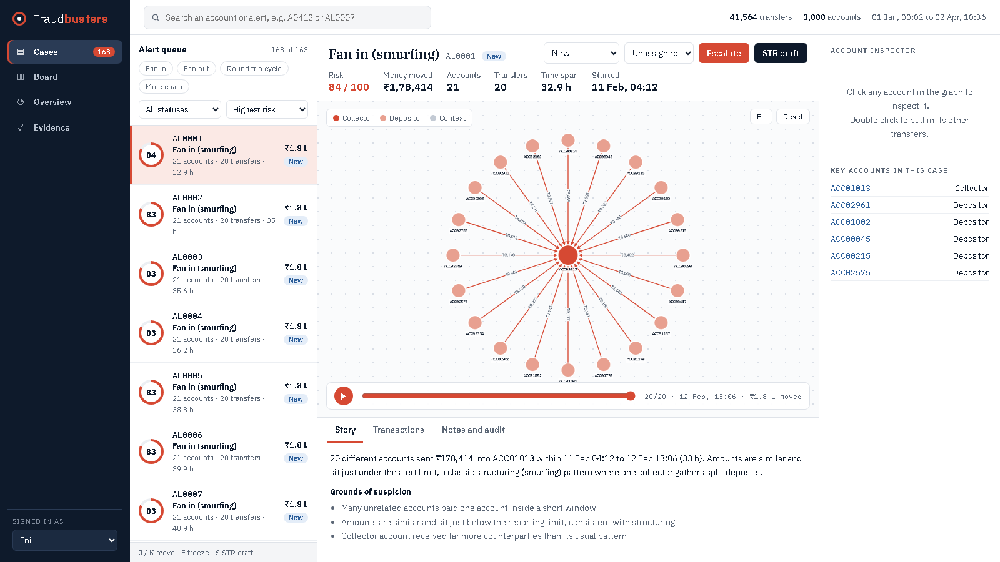

# Fraudbusters

**Graph based detection of layered money laundering networks**
Team **Yenrimedia** · Build Beyond '26, BMSCE · Problem statement **PS 2.1**
Ini Shetty · Jayane Muralimaran · Deekshith R



## The problem

Launderers hide money by *layering* it: splitting it into many small deposits, passing it through mule
accounts, or sending it round in loops. Each single transfer looks harmless, so rule engines that check one
transaction at a time ("is it above ₹10,000?") miss the scheme. The crime is only visible in the **connections**.

## Our approach

Every account is a node and every transfer is a time stamped edge in a **directed graph**. Laundering
typologies become shapes we can search for:

| Typology | Shape | Rule (constants at the top of [`src/aml.py`](src/aml.py)) |
|---|---|---|
| Fan in (smurfing / structuring) | many → one | 8 or more distinct senders into one account within 72 h, similar or just under limit amounts |
| Fan out (dispersion) | one → many | 8 or more distinct receivers from one account within 72 h, large total |
| Cycle (round tripping) | loop | money returns to its origin in 3 to 6 hops, each hop within 48 h, 90 to 100 % of the amount kept |
| Mule chain | line | 3 or more hops, each forwarded within 6 h, 90 to 100 % kept (plus a "patient mule" tier: 48 h hops, 97 % kept, 4 or more hops) |

Every alert gets a **risk score from 0 to 100**:
typology weight × (0.40 pattern strength + 0.25 money at stake + 0.20 speed + 0.15 breadth).

```
transactions.csv → graph → 4 detectors → risk ranked alerts → Investigator Workspace (cases, money trail, STR report)
```

## Run it

**Windows:** double click `run.bat` (or run it from a terminal). It sets everything up the first time and opens
http://localhost:8600.
**Mac / Linux:** `./run.sh`

Manual steps, if you prefer (Python 3.11 or newer):

```bash
python -m venv .venv
.venv/Scripts/python -m pip install -r requirements.txt        # Mac/Linux: .venv/bin/python
.venv/Scripts/python -m uvicorn app.server:app --port 8600     # open http://localhost:8600
```

Run the tests: `.venv/Scripts/python -m pytest tests`

### Run it in VS Code

1. **File > Open Folder…** and pick this folder. Install the recommended **Python** extension when VS Code asks.
2. First time on a new laptop: **Terminal > Run Task… > Setup: create .venv and install packages** (or double click `run.bat` once).
3. Open **Run and Debug** (Ctrl+Shift+D), choose a configuration, press **F5**:

| Configuration | What it runs |
|---|---|
| 1. Fraudbusters Workspace | the web app; the browser opens http://localhost:8600 |
| 2. Detection engine in the terminal | `src/aml.py`: prints the alerts and precision / recall / F1 vs the baseline |
| 3. Research dashboard | the Streamlit dashboard on http://localhost:8501 |
| 4. Regenerate synthetic data | `data/generate_synthetic.py` |
| 5. IBM model | `src/ibm_model.py` (needs the Kaggle files) |
| 6. Run all tests | the 16 tests in `tests/` |

Tip: click left of a line number in `src/aml.py` (for example inside `detect_cycles`) to set a red breakpoint, then run
configuration 2: VS Code pauses there and you can inspect the money trail step by step.

### What you can do in the Workspace

* **Cases:** alert queue ranked by risk, interactive money trail graph, ▶ replay of the scheme in time order,
  account inspector, *Follow money* forward and back, freeze requests, notes and a full audit trail.
* **STR draft:** one click PDF of a Suspicious Transaction Report for FIU-IND (a draft for the analyst, not a filing).
* **Board:** drag cases between New, Investigating, Escalated, Reported and Closed.
* **Overview** and **Evidence:** charts of alerts, money at risk, and accuracy on synthetic and IBM data.
* Keys: J / K next and previous case, Space replay, F freeze, S STR draft.

There is also a Streamlit research dashboard (`streamlit run app/dashboard.py`) with the red team game,
early warning replay and bank consortium simulation.

## Results

**Synthetic data** (seed 7, 41,564 transactions, 1,650 laundering, 160 planted schemes):

| System | Precision | Recall | F1 |
|---|---|---|---|
| Threshold baseline (amount ≥ ₹10k or ≥ 10 tx a day) | 0.41 | 0.49 | 0.45 |
| **Fraudbusters** | **0.86** | **0.93** | **0.90** |

**Real format data: IBM AML benchmark** (HI Small, Kaggle). Trained on 1 to 6 Sep, threshold picked on 7 Sep,
tested on unseen 8 to 10 Sep: 1.32 million transactions, only 0.11 % laundering.

| System | Precision | Recall | F1 | Alerts to review |
|---|---|---|---|---|
| Threshold baseline | 0.0015 | 0.57 | 0.003 | 560,549 |
| Fraudbusters rules only, untuned (first 3 days) | 0.0025 | 0.08 | 0.005 | 37,552 |
| **Fraudbusters IBM profile** (graph features + gradient boosting) | **0.42** | **0.43** | **0.42** | **1,556** |

Our hand tuned rules did not transfer to IBM's data (hops are days apart and many schemes follow no named shape),
so we built [`src/ibm_model.py`](src/ibm_model.py): per account graph features (unique senders and receivers,
pass through behaviour, payment rail) feeding a gradient boosted classifier, computed separately for each time
period so nothing leaks from the test days. 42 % of its alerts are real laundering, against 0.15 % for threshold
rules: an analyst checks 1,556 alerts instead of 560,549.

## Project structure

| Path | What it does |
|---|---|
| [`src/aml.py`](src/aml.py) | **Detection engine:** loads transactions, builds the graph, runs the 4 detectors, scores risk, evaluates against the baseline |
| [`src/str_report.py`](src/str_report.py) | Builds the STR draft PDF for an alert |
| [`src/ibm_model.py`](src/ibm_model.py) | Graph features + learned scorer on the IBM benchmark |
| [`src/ibm.py`](src/ibm.py) | Runs the plain rules on IBM data |
| [`src/scenarios.py`](src/scenarios.py) | Red team: design a scheme and see if it gets caught |
| [`src/early_warning.py`](src/early_warning.py) | How early in a scheme we raise the alarm |
| [`src/consortium.py`](src/consortium.py) | Banks sharing hashed account IDs vs working alone |
| [`app/server.py`](app/server.py) | **Backend:** FastAPI server, the Workspace's API |
| [`app/web/`](app/web/) | **Frontend:** `index.html`, `style.css`, `app.js` (Cytoscape.js graph, Chart.js charts) |
| [`app/dashboard.py`](app/dashboard.py) | Streamlit research dashboard |
| [`data/generate_synthetic.py`](data/generate_synthetic.py) | Generates labelled transactions with planted laundering cases |
| [`tests/`](tests/) | Detector and API tests |
| [`docs/CODE_GUIDE.md`](docs/CODE_GUIDE.md) | Plain English walk through of the code |

### API

| Method | Path | Returns |
|---|---|---|
| GET | `/api/alerts` | all alerts with risk and case status |
| GET | `/api/alerts/{id}` | one case: graph nodes and roles, transactions, grounds, case state |
| GET | `/api/accounts/{acct}` | an account's transfers and alerts |
| GET | `/api/trace` | follow money forward or back from an account |
| POST | `/api/cases/{id}` | change status, assignee, notes, freeze (written to the audit log) |
| GET | `/api/alerts/{id}/str.pdf` | STR draft PDF |
| GET | `/api/overview`, `/api/metrics` | dashboard numbers |

### Reproduce the extra results

```bash
.venv/Scripts/python data/generate_synthetic.py   # data/transactions.csv
.venv/Scripts/python src/aml.py                   # alerts + precision / recall / F1 in the terminal
.venv/Scripts/python src/scenarios.py             # data/redteam.csv
.venv/Scripts/python src/early_warning.py         # data/early_warning.csv
.venv/Scripts/python src/consortium.py            # data/consortium.json
.venv/Scripts/python src/ibm_model.py             # data/ibm_model_results.json (needs the Kaggle files in data/, about 90 s)
```

IBM data: download `HI-Small_Trans.csv` and `HI-Small_Patterns.txt` from Kaggle
(`ealtman2019/ibm-transactions-for-anti-money-laundering-aml`) into `data/`. They are too large for the repo.

## Limits and next steps

* Synthetic data follows our own assumptions, which is why we test on IBM's benchmark too.
* The red team shows where we can be beaten: hops more than 48 h apart, or fewer than 8 smurfs.
* Next: run the IBM model inside the Workspace, analyst logins, a live transaction stream, and AI written case notes
  (`llm_summary` in `src/aml.py`, needs `ANTHROPIC_API_KEY`).

Slides: [docs/FlowTrace_v4_IBM.pptx](docs/FlowTrace_v4_IBM.pptx)
